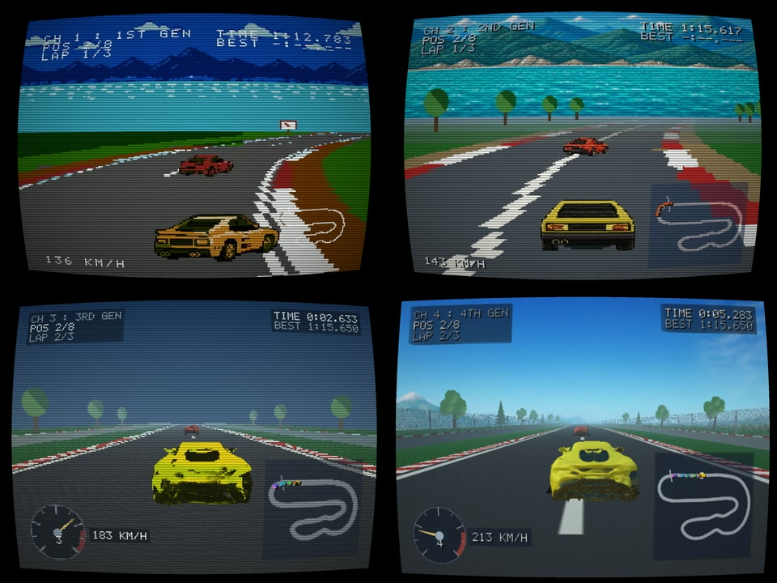

# Console Chaos Racing



FC / SFC / PS1 / PS2 の 4 世代表現を 1 つのシミュレーションの上で切り替えるエンジン
[ConsoleChaosEngine](https://github.com/Maoku/ConsoleChaosEngine)
を使って作ったレースゲームサンプル

**ブラウザですぐ遊べる: https://maoku.github.io/ConsoleChaosRacing/**

Claude Code / Opus5 で作成したもの。
車については
- 画像は GPT-Image-2
- 3Dモデルは Tripo3D P2.0 (旧モデルは Meshy)
を使って別途用意しています

- 要求仕様: [`Docs/PLAN.md`](Docs/PLAN.md)
- 実装計画: [`Docs/IMPLEMENTATION_PLAN.md`](Docs/IMPLEMENTATION_PLAN.md)


## セットアップ（gen1-fds 作業ブランチ）

Node.js 22以上。検証済みエンジンは `reference/console-chaos-engine-0.2.0-fds.tgz` に同梱し、lockfileで固定しています。

```sh
npm ci --cache /tmp/npm-cache
npm run dev -- --host 0.0.0.0 --port 5174
```

右下の「音声設定」で通常音源／拡張音源を選びます。拡張音源は第1世代のみ有効です。BGM・効果音音量・ミュートも保存します。
仕様・精度・曲構成は [FDS音源実装メモ](Docs/FDS_AUDIO.md) を参照してください。

FDS同梱Engineのスプライト規約に合わせ、素材は画像上端を画面上端として生成します。
旧版で使っていた事前の上下反転は不要です。修正範囲と回帰検証は
[スプライトの向き](Docs/SPRITE_ORIENTATION.md) を参照してください。

エンジンを再生成する場合は、隣のConsoleChaosEngineの **gen1-fds** ブランチで `npm run pack:distribution` を実行し、
`artifacts/console-chaos-engine-0.2.0.tgz` を上記 `-fds.tgz` 名でコピーして、
`npm install ./reference/console-chaos-engine-0.2.0-fds.tgz` でlockfileと依存を更新します。
`main` から再生成するとこの追加APIを利用できません。

## 開発

| コマンド | 内容 |
| --- | --- |
| `npm run dev` | Vite 開発サーバ（http://localhost:5173） |
| `npm run build` | 型チェック＋本番ビルド（`dist/`） |
| `npm run preview` | ビルド結果のプレビュー |
| `npm run deploy:pages` | `dist/` を `gh-pages` ブランチへ公開（下記） |
| `npm test` | Vitest（純ロジックのテスト） |
| `npm run typecheck` | 型チェックのみ |
| `npm run check:cars` | 変換済み車アセットの SHA-256 照合（※変換元 GLB は公開リポジトリに含まれないため、クローンした状態では変換元の照合が失敗する。[data/README.md](data/README.md) 参照） |
| `npm run prepare:cars` | 変換元 GLB から車の runtime GLB と base color テクスチャを焼き直す（`-- --write` で書き出し。姿勢・原点・寸法の正規化を焼き込み、**タイヤを車体から切り離して回転位相を 8 枚焼く**。※変換元が要る） |
| `npm run build:lamps` | 車体 GLB と塗装テクスチャからテールランプのメッシュを焼く |
| `npm run measure:pace` | 敵車の速度スケールとペース較正を実測（下記） |
| `npm run build:minimap` | コース中心線からミニマップ PNG とマーカーを生成 |
| `npm run build:assets` | 生成系アセットをまとめて再生成 |

### バランス定数の較正

`BALANCE.SPEED_SCALE`（敵車の速度倍率）と AI のペース較正は、**コース形状と車両定数から
決まる実測値**であって手で選べる数ではない。要求は「敵車が走行中に出す最高速度が自機の
0.95 倍」だが、直線が短いこのコースでは定数を 0.95 倍しても実測比は 0.971 にしかならない
（詳細は [`Docs/BALANCE_PLAN.md`](Docs/BALANCE_PLAN.md) §2.3）。

したがって**コース形状・車両定数・AI のライン計算を変えたら必ず流し直す**。

```bash
npm run measure:pace
```

実測が現在の定数とずれていれば異常終了する。出た値で `src/game/sim/` の定数を置き換える。

## 操作

| 入力 | 動作 |
| --- | --- |
| ← → | ステア |
| Z | アクセル |
| X | ブレーキ |
| C | 視点切替（第3・第4世代） |
| Q / E | 世代切替（前 / 次） |
| 1〜4 | 世代の直接指定（HUD の `CH n` と対応） |
| F | フラットディスプレイ（画面の丸み）の ON / OFF |
| M | モアレ（走査線と蛍光体マスク）の ON / OFF |
| Esc | ポーズ |
| Backspace | タイトルへ戻る |

タイトル画面を 5 秒放置すると、5 秒ごとに 1 → 4 世代を巡回する（何か操作すると止まる）。

## GitHub Pages へ公開する

公開先は https://maoku.github.io/ConsoleChaosRacing/ 、配信元は `gh-pages` ブランチの
ルート（リポジトリの Settings → Pages → Source: *Deploy from a branch*）。

```bash
npm run build
npm run deploy:pages
```

`tools/deploy-pages.sh` が `dist/` をそのまま `gh-pages` ブランチへ置いて push する。
`.nojekyll` も一緒に置くので Jekyll の加工は入らない。

**ビルドは手元で行い、GitHub Actions では行わない。** 本リポジトリはエンジンを Git 管理外の
`reference/console-chaos-engine-0.2.0.tgz` から `file:` で参照しているため（上記セットアップ）、
クローンしただけの環境では `npm install` が通らない。エンジンの `main` から都度ビルドし直すと
中身が動作確認したものとずれる（「セットアップ」§2 の注記）。手元で確かめた現物をそのまま
配るほうが再現性が高い。

Vite の `base` は `'./'`（`vite.config.ts`）。生成物の参照が相対パスになるので、
`/ConsoleChaosRacing/` のようなサブパス配信でも素材の 404 が起きない。

## 動作要件

WebGL2 が使えるブラウザ。エンジンは ESM / ES2022 前提でビルドされている。

## ライセンス

MITライセンス

